# Project I.G.I. — Story, Characters & Missions

## The Story, Mission by Mission

David Jones and Anya chase a stolen nuclear warhead from Josef and Jach Priboi to Ekk — plus the intro, new interlude missions, and ending.

The trail runs from **Josef Priboi** to his uncle **Jach**, the arms dealer who organised the theft, and ends with **Ekk**, a hard-line nationalist who runs her camp from an old KGB redoubt and turns the warhead into a suitcase bomb.

*All original story detail below comes from the game's briefings, radio lines and movie subtitles; quotes keep the original spelling.*

---

## The Intro Movie

The game opens with a caption, **"Somewhere in Russia."**, and a man named Priboi questioning a prisoner. He asks a guard *"Is he still not talking?"*, hears *"No, he's a tough one"*, and answers *"Now let's do it my way."* The subtitles never say which Priboi it is.

### Operation Flashpoint: Cold War Crisis — Project I.G.I. Remake (New)

**EXT. HELICOPTER → INT. HELICOPTER**

**DAVID JONES** (remastered character model) looks into camera:

> "My name is David Jones. I work for the I.G.I. Special Forces. My mission—"

Cut. Camera shifts to **ANYA**, inside the helicopter, talking to Jones. The player is locked in first person — can't move — but can see Jones's legs.

**Music cue:** *"Keep Hope Alive"* by The Crystal Method.

Then transition to gameplay. In multiplayer, other characters can stand or sit in the helicopter — same as the original Operation Flashpoint.

---

## Mission Sequence Overview

1. Trainyard
2. SAM Base
3. Military Airbase
4. **Eagle’s Inferno** *(NEW MISSION)*
5. **Landing Protocol** *(NEW MISSION)*
6. **Base of Operations** *(NEW MISSION)*
7. GOD
8. Radar Base
9. Get Priboi
10. Border Crossing
11. Re-Supply
12. Missile Trainyard
13. Defend Priboi
14. Eagle's Nest I
15. Eagle's Nest II
16. Nuclear Infiltration
17. Finding The Bomb

---

## Part One: Finding Josef (Missions 1–3)

### Mission 1 — Trainyard

Anya opens the case: a warhead has been stolen and Josef Priboi is *"our only link with the heist of the warhead."* His mobile phone was traced to a military airfield with strong air defences, so Jones starts far away and must steal a truck from a goods yard.

**Objective:** Get transport, disable the air defences, extract Josef.

### Mission 2 — SAM Base

The truck is too slow for Josef's escape, and Josef, who even knew the warhead's serial number, must come out alive. Jones takes C4 from a warehouse, plants a charge on each SAM launcher and is picked up by helicopter.

### Mission 3 — Military Airbase

Jones reaches the basement of the security building and finds the cells empty. Anya works out that Josef was moved by air, so Jones checks the flight logs in the control tower.

The log shows something odd: there were *"two Pribois on board."* With heavy chopper activity reported within 10 km, the helicopter pickup is called off and Jones escapes in a stolen fighter jet.

---

## Part Two: Behind Enemy Lines (Missions 4–6) *(New)*

### Mission 4 — Eagle’s Inferno *(NEW)*

At the conclusion of Mission 3, Jones steals an enemy fighter jet to escape hostile territory. However, the enemy quickly mobilizes their air force to intercept him. To ensure his survival, Jones must navigate treacherous airspace, evade advanced defenses, and engage in a high-stakes dogfight through a winding canyon. 

As Jones enters friendly airspace during his final escape, his jet takes a direct hit from enemy fire. With critical systems failing, he is forced to eject mid-flight.

### Mission 5 — Landing Protocol *(NEW)*

Catapulting from the burning jet, Jones parachutes down near the wreckage deep in enemy territory with only the gear he managed to hold onto. He must stay on the move as relentless enemy patrols and trained German Shepherds hunt him down. 

Spotting a radio tower in the distance, Jones fights through the tightening perimeter to send an emergency extraction signal, destroys the radio equipment to prevent enemy interception, and reaches the extraction point.

### Mission 6 — Base of Operations *(NEW)*

After narrowly escaping from behind enemy lines, Jones is flown back to the IGI Command Base for debriefing and resupply. He meets with Anya and the commander, tests gear in the shooting range, and speaks with allies—including an intel officer who mentions a “black site” called **G.O.D** starting to go dark—before collecting his updated briefing.

---

## Part Three: Jach the Hammer (Missions 7–9)

### Mission 7 — GOD

The flight log leads to a prison. Jones's backup has arrived, led by Captain Harrison, an ex Green Beret. Harrison's men will storm the prison, and Jones covers them as a sniper.

He jokes that he gets to *"play god"*, so Anya makes **God** his call sign and **Moses** Harrison's.

During the assault Anya identifies the second Priboi: **Jach**, aged 45, Josef's uncle, a *"businessman"* and smuggler. His nickname is **Jach the Hammer**, from the claw hammer he uses in beatings.

Harrison's team gets Josef out.

### Mission 8 — Radar Base

The debrief was easy, Anya says, because Josef had already been badly beaten, mostly by Jach.

Jach organised the theft, and with over 50 properties the warhead could be anywhere. Instead Jones uploads a virus into a radar dome so Anya can listen in on Jach's private channels.

It works, but the news is bad: Jach has already traded the warhead away.

### Mission 9 — Get Priboi

The target here is Jach, not Josef.

Thanks to the virus, Anya knows he is holding an arms sale at a remote storage yard. Jones blows up the fuel dump to flush him out, and Harrison's team ambushes the limo on the exit road and arrests him.

The pilot is wounded, so Jones flies Jach out himself.

---

## Part Four: Shot Down (Missions 10–13)

### Mission 10 — Border Crossing

On the flight out, a woman's voice claiming to be Russian air control orders the helicopter to change course.

Jach recognises her at once: *"That's her!"* She gives the order to fire, and the helicopter goes down.

She orders her men to bring Priboi to her. When a soldier asks about *"the English soldier"*, she answers *"Kill him!"*

Jones wakes up in the snow with a headache. Jach is gone, and so is his gear, map computer included. Anya sends him to a border checkpoint, where he gets on a truck crossing the border.

### Mission 11 — Re-supply

The truck delivers Jones to a forward base of a rapid reaction force.

He breaks out of the infantry base, recovers his map computer and a homing beacon from the ammo building, and puts the beacon on a SAM launcher.

Anya has one of the unit's own jets bomb it to *"look just like a training accident."* Harrison's people then track Jach to a train.

### Mission 12 — Missile Trainyard

Moving a prisoner by rail tells Anya the enemy is a small group, possibly rogue army officers, perhaps a political extremist.

Jones guesses they want Jach alive to learn how big a threat IGI poses.

Jones gets into the rail yard, keeps the alarms off so the train does not turn back, and boards it.

### Mission 13 — Defend Priboi

Jach complains: *"First you kidnap me, and then you loose me."*

Then two jets attack and the woman orders them to stop the train.

After the crash, Jones collects proximity mines and protects Jach until the evacuation team reaches the highest building in an abandoned village.

---

## Part Five: Ekk (Missions 14–17)

### Mission 14 — Eagle's Nest I

The woman from the radio is **Ekk**, and Anya has found her base.

Ekk uses an old KGB redoubt in the ruins of a castle as a training camp, on a rocky outcrop that only a cable car reaches.

Jones picks up a sniper rifle, switches the generator back on and rides the cable car to the top.

### Mission 15 — Eagle's Nest II

Anya explains the castle's past: it has stood since the 1300s, was handed from the KGB to the army in 1990 and was left to rot, until Ekk paid the local commander to look away.

Jones finds the warhead *"totally dismantled"*. Ekk has built a suitcase bomb — a small, portable nuclear device.

Ekk escapes by helicopter under cloud cover.

Anya learns Ekk is a hard nationalist who wants arms spending at pre-Glasnost levels and hates joint US and Russian anti-missile research. That points to a research facility whose comms just went offline.

### Mission 16 — Nuclear Infiltration

The target is a former plutonium refining plant with a working reactor, now used for anti-missile research.

Jones secures the deployment zone, then Anya, Harrison and his men land by chopper.

### Mission 17 — Finding the Bomb

Ekk's men took the plant disguised as support staff.

Anya will defuse the bomb herself, because she has three years of electronics and nuclear physics behind her.

Jones fights through sentry guns and a failing coolant system. Ekk taunts him along the way until he kills her (*"You got her!"*).

Anya reaches the bomb while Jones guards her, and defuses it: *"I did it."*

If she is killed (*"Jones! I'm hit!"*), the mission fails.

---

## The Ending Movie

The outro movie picks up after the bomb is defused.

Jones checks on Anya and she answers *"...yeah"*. He realises they had no clearance: *"This was a black op..."*

A loudspeaker announces the Rapid Reaction Force **Draka Tyegrus**, tells them to surrender, and warns that anyone armed will be shot.

Anya says there must be hundreds of soldiers between them and the FRV.

The game ends on Jones's last line, which is also its title:

> **"I'm going in!"**

---

## The Characters

### David Jones

The player, an IGI agent. He is cocky and jokes his way through every briefing (*"Another success for David Jones! IGI!"*).

### Anya

Jones's handler. She gives every briefing and runs the intercepts. In the last mission she comes in herself and defuses the bomb while Jones guards her.

### Josef Priboi

The first target and the first lead. He knew how the warhead was stolen. Freed in Mission 7 (originally Mission 4), he gives Anya the codes to Jach's comms channels.

### Jach Priboi

*"Jach the Hammer"*, Josef's uncle, the arms dealer who organised the theft and sold the warhead on. He knows Ekk by voice.

### Ekk

The villain, a hard-line nationalist running her own operation from an old KGB castle redoubt. She shoots down Jones's helicopter, attacks the train, builds the suitcase bomb and dies in the reactor plant.

### Captain Harrison

Leader of the backup team, call sign **Moses**. He leads the prison assault and the limo ambush.

---

# Project I.G.I. — Complete Mission Objectives & Design Docs

Every briefing, objective, and custom mission specification in sequential order (17 Missions Total).

- [Original Project I.G.I. — 14 Missions](https://playigi.com/missions.html#igi1)
- [IGI 2: Covert Strike — 19 Missions](https://playigi.com/missions.html#igi2)

---

## Mission 01 / 17 — Trainyard

[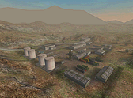](https://raw.githubusercontent.com/igiteam/openofpcwc-projectigi/refs/heads/main/project-igi/m01.png)

*Small coastline trainyard*

1. Steal the truck near the main entrance.

---

## Mission 02 / 17 — SAM Base

[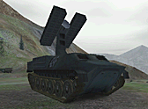](https://raw.githubusercontent.com/igiteam/openofpcwc-projectigi/refs/heads/main/project-igi/m02.png)

*Small missile defence base*

1. Locate and retrieve the C4 charges from the warehouse.
2. Place one charge on each of the SAM launchers.
3. Proceed to the extraction point.

---

## Mission 03 / 17 — Military Airbase

[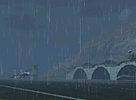](https://raw.githubusercontent.com/igiteam/openofpcwc-projectigi/refs/heads/main/project-igi/m03.png)

*Rescue Josef from the airbase*

1. Locate and rescue Josef Priboi from inside the security building.
2. Escort Josef Priboi to the extraction point.
3. Find Josef Priboi's new position by checking the flight logs in the control tower.
4. Escape by stealing one of the fighter jets.

---

## Mission 04 / 17 — Eagle’s Inferno *(NEW)*

*Escape enemy airspace in the stolen fighter jet*

**Technical Note:** Introduces `airplane_dm.pk3`

### Mission Objectives
1. **Escape the Airbase Airspace (Takeoff Under Fire):** Start in the cockpit with alarms blaring, power up the jet, and evade small arms and SAM fire during takeoff.
2. **Survive the Skies (Dogfight with Interceptors):** Engage enemy fighters using machine guns, flares, and limited homing missiles.
3. **Destroy Key Targets (Bomb Enemy Defenses):** Perform high-speed bombing runs on the radar station and SAM site blocking the route to safety.
4. **Final Escape (Run the Canyon):** Fly through a winding canyon to avoid radar detection, evading final enemy fighters and automated turrets before reaching friendly airspace.

### Gameplay Features & Mechanics
- **Flight Controls (Simplified for Accessibility):**
  - **Rolls and Yaws:** Maneuver to avoid missiles or line up targets.
  - **Speed Boost:** Short bursts for tactical advantage.
  - **Countermeasures:** Deploy flares to throw off heat-seeking missiles.
- **Weapons:**
  - **Machine Guns:** Unlimited ammo with a moderate cooldown.
  - **Homing Missiles:** Limited supply for dogfights.
  - **Bombs:** Manual targeting for ground objectives.
- **Dynamic Encounters:** Intense enemy radio chatter/taunts, missile lock warnings, near-miss effects, and scripted mid-air hazards.

### Key Cinematic Moments
1. **Takeoff:** Narrowly escaping ground fire and missiles down the runway with explosions in the background.
2. **Dogfight Highlight:** Flying through a cloudbank to break lock-on or baiting two jets into a midair collision.
3. **Canyon Escape:** Narrowly dodging falling debris and collapsing rock formations.
4. **Mission End & Transition:** Entering friendly airspace before taking a direct hit from enemy fire, forcing Jones to eject mid-flight.

---

## Mission 05 / 17 — Landing Protocol *(NEW)*

*Escape from enemy territory after ejecting*

**Technical Note:** Introduces `ai_dogs_partol` and utilizes built-in airborne mechanics from *MOH: Spearhead*.

### Loading Screen & Intro
Using the built-in airborne mechanics from *MOH: Spearhead*, the game resumes mid-air as Jones catapults from the burning jet. The parachute deploys automatically with a sweeping view of the wreckage crashing nearby, forcing the player to land near the smoke plume.
- **Ambient SFX:** Dogs barking, wind howling, distant shouts.

### Mission Objectives
1. Navigate the hostile terrain under pressure from enemy patrols and tracking German Shepherds.
2. Reach the radio tower and use it to send an emergency extraction signal.
3. After activating the radio, destroy the equipment to avoid enemy interception.
4. Make your way to the extraction point before enemy forces close in.

---

## Mission 06 / 17 — Base of Operations *(NEW)*

*Debrief and resupply at IGI Command Base*

**Location:** IGI Command Base | **Tone:** Low-intensity, semi-interactive, character-driven  
**Technical Note:** Utilizes `test_door.pk3`

### Mission Goals
1. **Debriefing:** Meet with Anya and the commander for a short debriefing on the previous mission.
2. **Gear Customization / Shooting Range (Optional):** Try out weapons in the shooting range and participate in target challenges, time trials, or accuracy tests (`test_door.pk3`).
3. **Story Expansion (Optional Dialogues):** Speak with allies about upcoming threats or previous ops; an intel officer mentions a “black site” called G.O.D starting to go dark.
4. **Prep for Next Mission:** Collect the updated briefing for Mission 7: **GOD**.

### Gameplay Style & Narrative Function
- **Gameplay Style:** Exploratory and non-linear with no combat pressure, allowing the player to test game mechanics in a sandbox environment.
- **Narrative Function:** Provides pacing before the intensity of *GOD*, builds immersion in the IGI world, and naturally introduces weapon upgrades or new gadgets.

---

## Mission 07 / 17 — GOD

[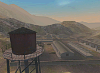](https://raw.githubusercontent.com/igiteam/openofpcwc-projectigi/refs/heads/main/project-igi/m04.png)

*Defend the friendly troops*

1. Secure the village and climb the water tower ready to cover the friendly troops.
2. Provide cover for the friendly troops until Josef has been freed.

---

## Mission 08 / 17 — Radar Base

[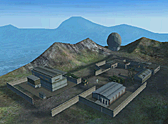](https://raw.githubusercontent.com/igiteam/openofpcwc-projectigi/refs/heads/main/project-igi/m05.png)

*Disrupt Jach's communications network*

1. Locate the radar dome keycard.
2. Insert the virus into the radar dome terminal.
3. Secure the extraction zone.

---

## Mission 09 / 17 — Get Priboi

[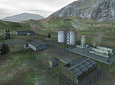](https://raw.githubusercontent.com/igiteam/openofpcwc-projectigi/refs/heads/main/project-igi/m06.png)

*Kidnap Jach from his base*

1. Obtain explosives from his main warehouse.
2. Shutdown generator - to disarm electric fence.
3. Set charges on fuel dump to make Priboi flee the saftey of his warehouse.
4. Search all filing cabinetts for encriminating evidence.

---

## Mission 10 / 17 — Border Crossing

[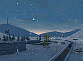](https://raw.githubusercontent.com/igiteam/openofpcwc-projectigi/refs/heads/main/project-igi/m07.png)

*Get Jones across the border*

1. Infiltrate border crossing.
2. Alarm must not be raised when you get into truck.
3. Pass the security checkpoint.
4. Infiltrate bordercrossing.
5. Get to truck crossing border before timer expires.

---

## Mission 11 / 17 — Re-supply

[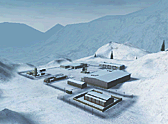](https://raw.githubusercontent.com/igiteam/openofpcwc-projectigi/refs/heads/main/project-igi/m08.png)

*Get Jones' equipment back*

1. Escape from infantry base.
2. Infiltrate tank maintenance yard, and gain access to ammo storage building.
3. Obtain map computer and homing beacon.
4. Fix and set homing beacon on SAM launcher for airstrike.
5. Infiltrate listening post and radar.
6. Move to ERV.

---

## Mission 12 / 17 — Missile Trainyard

[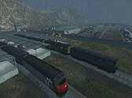](https://raw.githubusercontent.com/igiteam/openofpcwc-projectigi/refs/heads/main/project-igi/m09.png)

*Get on the train*

1. Enter base and disarm security system.
2. Enter high security compound and board train.
3. Eliminate all resistance.

---

## Mission 13 / 17 — Defend Priboi

[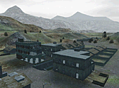](https://raw.githubusercontent.com/igiteam/openofpcwc-projectigi/refs/heads/main/project-igi/m10.png)

*Take Jach to the FRV*

1. Obtain proximity mines from storage depot.
2. To proceed to highest building in abandoned village and await evacuation.

---

## Mission 14 / 17 — Eagle's Nest I

[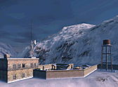](https://raw.githubusercontent.com/igiteam/openofpcwc-projectigi/refs/heads/main/project-igi/m11.png)

*The approach to Ekk's fortress*

1. Locate and retrieve the sniper rifle.
2. Power up the cable car by switching the generator back on.
3. Activate the cable car controls.

---

## Mission 15 / 17 — Eagle's Nest II

[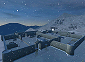](https://raw.githubusercontent.com/igiteam/openofpcwc-projectigi/refs/heads/main/project-igi/m12.png)

*Ekk's hilltop fortress*

1. Locate the bomb and disable it, Find Ekk and kill her.

---

## Mission 16 / 17 — Nuclear Infiltration

[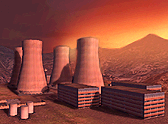](https://raw.githubusercontent.com/igiteam/openofpcwc-projectigi/refs/heads/main/project-igi/m13.png)

*Infiltrate the nuclear base*

1. Penetrate the perimeter.
2. Secure deployment zone for Anya and friendly forces.
3. Power on the Generator in the Generator building.
4. Turn on the transformator in the large storage building.
5. Open the doors for the weapons factory.
6. Get trough the weapons factory.
7. Get past the entrance to the cooling tower section without the alarm going off...
8. Enter the Underground complex.

---

## Mission 17 / 17 — Finding the bomb

[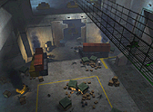](https://raw.githubusercontent.com/igiteam/openofpcwc-projectigi/refs/heads/main/project-igi/m14.png)

*Kill Ekk and find the bomb*

1. Find Ekk and kill her.
2. Locate the bomb and disable it.

---

*Project I.G.I. © Innerloop Studios / Eidos Interactive, 2000.*
